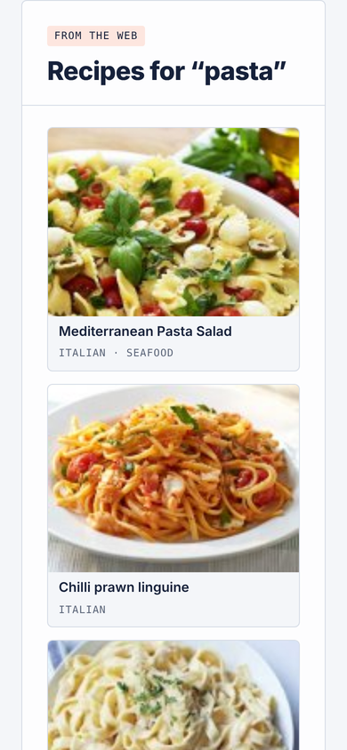
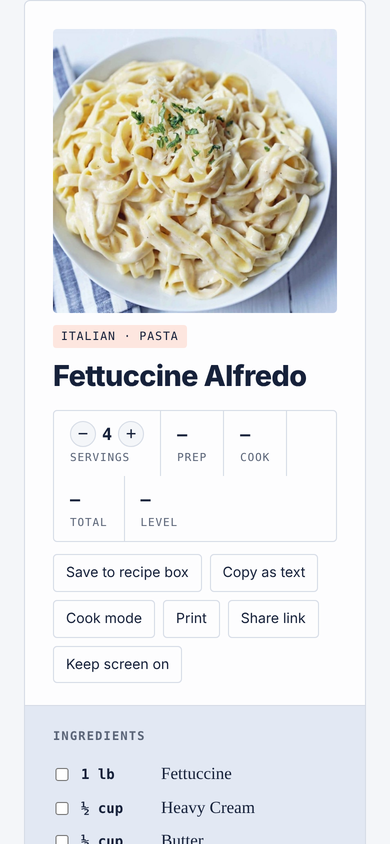
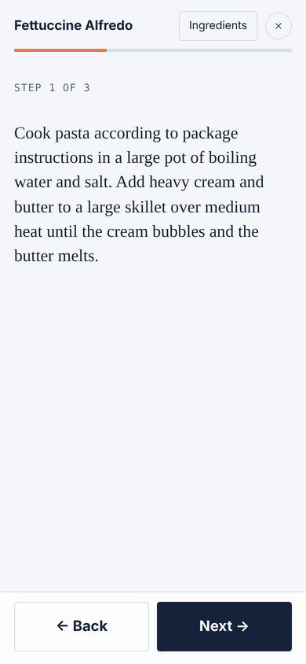
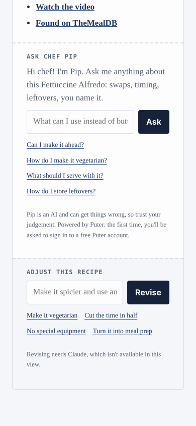

# Test Kitchen

Search for any dish and get a real recipe from the web, with photos, the original source and video links, step timers, unit conversion and a recipe box. Recipes come from [TheMealDB](https://www.themealdb.com), a free recipe library.

**Open it:** https://ewantait813-svg.github.io/recipie-generator/ (the correctly spelled https://ewantait813-svg.github.io/recipe-generator/ redirects there too)

**Full AI version on claude.ai:** https://claude.ai/artifact/ES56QVvN9pjXCN2agBTytx

  
  
  
  

## What it does

- **Search** by dish name ("lasagne"), category or cuisine ("pasta", "desserts", "Thai food"), and filter for vegetarian or vegan. An exact name opens the recipe straight away.
- **Use what I have:** list everything in your fridge ("chicken, rice, onion, no mushrooms") and recipes are ranked by how many of your ingredients they use, with what you'd still need to buy shown on each one.
- **Drinks:** search "smoothie", "protein shake" or "lemonade", or tap **Drinks** or **Protein shakes** under Browse. Non-alcoholic drinks come from [TheCocktailDB](https://www.thecocktaildb.com) (alcoholic drinks are always filtered out), plus Test Kitchen's own protein shakes, protein smoothies, sports drinks and everyday drinks with protein and calories per serving.
- **Shopping list:** tap *Add to shopping list* on any recipe. Items are grouped by store aisle, quantities from different recipes add up, and you can tick things off, copy or share the list. It's saved in your browser.
- **This week:** once your recipe box has recipes, pick one for each day of the week, open it from there, and add the whole week to your shopping list in one tap (a recipe planned twice counts twice).
- **Calories and protein** on about 9 in 10 web recipes: a rough per-serving estimate worked out from the ingredient amounts (labelled as an estimate, with the whole-recipe total, since web recipes don't say how many they serve).
- **Recipes** rescale when you change the servings, switch between US and metric units, and have tap-to-start timers on the steps.
- **Cook mode** shows one big step at a time with back/next buttons, swipe and arrow keys, the step's timer, an ingredients checklist, and keeps your screen awake.
- **Ask Chef Pip** under every recipe answers questions about it: swaps, timing, leftovers, making it vegetarian. Pip uses Chrome's built-in AI on computers that have it, [Puter](https://docs.puter.com/user-pays-model/) on phones and other browsers (free, with a Puter sign-in the first time), and Claude on claude.ai.
- **Trending** ranks the dishes the world is reading about most this week by English Wikipedia page views, refreshed every day at 6am Pacific by a GitHub Action.
- **Athlete diet:** enter your sport, position, age, weight, training load and season, and Claude builds a daily fueling plan with calorie and macro targets, what to eat around training, sample meals, hydration tips and a grocery list. Plans for athletes under 18 never include calorie cutting or supplements.
- **Share link, Print, Keep screen on** and a **recipe box** saved in your browser.
- **Installable and works offline** once visited: add it to your home screen from the browser's share or menu button.
- **Settings** (gear button): light, dark and system themes, accent colors, text size, units, timer sound, compact layout, reduced motion, which tab to open on, and reset buttons.

## How it works

`index.html` is a single self-contained page. Recipe search calls the free public APIs of TheMealDB and TheCocktailDB straight from the browser, so it works anywhere, including GitHub Pages.

Athlete diet plans and full recipe rewrites ("Adjust this recipe") ask Claude through the claude.ai Artifact runtime (`window.claude.use("sample")`), so they need the claude.ai version. On GitHub Pages the plan button links there, each example meal finds a web recipe instead, and "Adjust this recipe" asks Chef Pip to explain the changes. On claude.ai, if the recipe library can't be reached, Claude develops the recipe instead.

`trending/update.mjs` fetches Wikipedia page views for the dishes in `trending/dishes.json` and writes `trending.json`; `.github/workflows/trending.yml` runs it daily. `sw.js` caches the page for offline use, and `404.html` sends mistyped addresses back to the home page.
